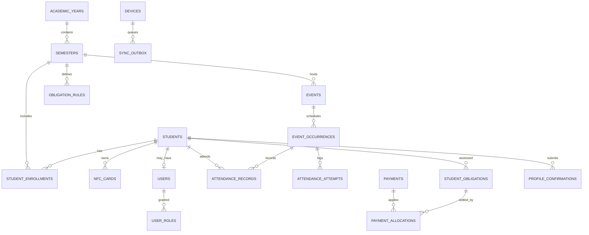

# UniTap: Phase 1 database, offline-first architecture and rollout

**Scope:** Architecture / schema / auth UI **design artifacts**, not yet wired into the Ionic application. Database DDL validated with `sqlite3`. This version intentionally does **not** turn on live cloud syncing, real financial payments, or self-service admin registration.

## Goals and decisions

- **First-class semester history.** `academic_years -> semesters -> student_enrollments`; student master records hold stable school IDs and latest name/photo; enrollment rows preserve year, section, course, and name snapshot for each semester. One active semester; opening a new semester does not change or delete the prior one.
- **Per-semester mandatory confirmation.** On a new term, make a `profile_confirmations` row with `PENDING` for every active enrolled student. Student submits updated contact/photo/name as approved by school policy; officer approves or rejects. Pending/unreviewed users are visibly flagged. Allow critical access (login, profile update) even while pending; block or limit elective actions by policy, not automatically offline attendance.
- **Offline-first device.** Native Android local SQLite is authoritative for offline reads/writes. A device is fully usable with no connection after one secure provisioning. Use SQL transactions, indexes, foreign keys, and schema migrations. Capacitor Preferences is for lightweight UI settings only, not lists/finances.
- **Stored images.** Keep student photo bytes in secured app-private files; SQLite holds a file URI + content digest. A scan loads the name, school ID, year/section, and photo (or placeholder). Photo is *visual verification*, not automatic face recognition.
- **Attendance fraud handling.** Scanning opens a pending verification display. Officer must press **Confirm student** to create a PRESENT/LATE record; if the photo doesn't match, press **Reject: wrong person**. Every attempt is logged, including rejected ones. Officers can VOID a previous accepted attendance with a mandatory reason; keep an immutable audit event. If voiding causes an absence fine, reevaluate only after the occurrence is closed and appeal policy is applied.
- **Fines AND contributions.** Rules defined per semester with trigger and amount; separate student obligations and payment allocations support partial payments, waivers/adjustments, and reversals. Reports group by semester, type, student, year/section, issued/paid/balance. Amounts are centavos; real cash records require accounting controls. The wallet remains **simulated** only.
- **Roles:** DEVADMIN, OFFICER, STUDENT. Roles live in `user_roles`, not in a user-selectable register dropdown. DEVADMIN provisioning is restricted. Officer access may be semester-bound. Student can only see their own personal, attendance, and finance records.
- **CSV:** Exactly `school_id,first_name,middle_name,lastname,year,section`. Select school year/semester and program in the import wizard; they are not extra CSV columns. School ID is text; middle name can be empty; default year range 1-4 configurable. Preview rows, detect duplicates, validate, import in one database transaction and log each row. Import should only insert/update the targeted semester enrollment, never overwrite historical terms. Import does NOT create a password or link an NFC card.
- **Sync later.** Record domain changes and outbox entries in the **same transaction**. On reconnect, push by unique operation ID, server acknowledges idempotently, then pull incremental updates by cursor. Conflicts are recorded for review. Never silently merge payment allocations, role changes, card assignments, or attendance voids; designate an authoritative device/session for offline collection to avoid double-spending and split-brain scanning. Financial operations require reconciliation and explicit dispute policies before multi-device use.

## Relationships (abbreviated)

## Authentication flows

### Secure initial setup (not public registration)
1. Authorized deployment procedure provisions the initial DEVADMIN, device, encrypted database, and unique credentials. **No hardcoded admin credentials or open `sign up as admin` UI.**
2. DEVADMIN adds OFFICER users and sets their scoped role and device access.
3. OFFICER imports the student master roster and issues time-limited, one-use student activation codes; on a fully offline deployment, a supervised claim should occur **on that device** or be protected by a pre-provisioned signed invitation.
4. STUDENT registration: enter school ID + officer-issued activation code -> display matching profile (without exposing it before validated claim) -> set password -> account created as STUDENT only.
5. Login: username / school ID + password, local verification against *Argon2id password hash*, with OS keystore protection for encryption keys. Offer biometric/PIN device unlock only once a legitimate account has previously authenticated.
6. When device is offline, existing provisioned users can unlock within a configurable offline trust window. Not-yet-provisioned users need local officer-supervised provisioning. Revoked accounts cannot reliably be blocked on disconnected devices until sync; make this explicit in policy.
7. Restrict login attempts, protect secrets from backups, and never store plaintext password, student photo or activation token in logs/outbox.

### UI screens (see `04_auth_ui_prototype.html`)
- Welcome / Login: UniTap brand, school organization, school ID/username, password, show password, Sign in, connection status, Student registration link.
- Student registration: school ID, activation code, password, confirm password; account claim is student-only. Never let user choose admin/officer role.
- Officer invitation: only visible to a DEVADMIN from an authenticated admin flow.
- First login after academic term change: mandatory semester profile review, with full name, program, year/section, photo, changed fields, Submit for approval. Approve/reject for officers.
- Roles redirect: DEVADMIN -> system control; OFFICER -> scans/events/students/reports; STUDENT -> profile, ID, attendance, fines and contributions.

## Suggested design tokens (accessible, restrained, campus-friendly)

| Token | Value | Usage |
|---|---|---|
| `--uni-primary` | `#0F766E` | Primary buttons and links |
| `--uni-primary-dark` | `#115E59` | Active / pressed state |
| `--uni-ink` | `#0F172A` | Titles and high-contrast text |
| `--uni-muted` | `#64748B` | Secondary copy |
| `--uni-background` | `#F8FAFC` | App background |
| `--uni-surface` | `#FFFFFF` | Cards, forms |
| `--uni-border` | `#CBD5E1` | Field borders |
| `--uni-warning` | `#B45309` | Pending verification / overdue |
| `--uni-danger` | `#B91C1C` | Void/reject/errors |
| `--uni-success` | `#047857` | Confirmed attendance |

Use one primary accent, neutral surfaces, restrained gradients, readable text, and color plus labels (not color alone) for status. Avoid mixing neon mint, blue, purple and peach as equal primaries.

## CSV import validation rules

- Accept UTF-8 CSV with BOM or UTF-8 plain; trim values; preserve leading zeros in `school_id`; case-fold only for matching.
- `school_id` unique, required; name fields required except `middle_name`; `year` integer 1-4 (configurable); `section` nonempty.
- Duplicate school IDs within one file => error rows, not two enrollments. Existing school ID => update student current fields only according to approval policy, and upsert the **selected semester enrollment**; never update older enrollment rows.
- Show counts: inserted, existing, invalid; allow review before commit. The import's selected semester should be explicit. No file formula execution; neutralize `=`, `+`, `-`, `@` if exporting as a spreadsheet.
- Use UUIDs for internal relations, not the school ID. Save row-by-row import errors to `import_rows`.

## Repository integration plan

1. Create `src/database/migrations/001_initial.sql` from schema and a typed `Database` adapter. Choose an Android Capacitor 8-compatible SQLite provider and validate SQLCipher/device key handling; use a separate web adapter for browser dev.
2. Add `student`, `event`, `attendance`, `finance` repositories backed by SQL. Keep service interfaces so Ionic pages remain mostly unchanged.
3. Before any migration: make a verifiable encrypted export of existing `nfc_inspector_students_v1`, `unitap_events_v1`, and `unitap_finance_v1`. Detect and repair duplicates, convert `studentNumber -> school_id`, `yearLevel/section -> enrollment`, `cards -> nfc_cards`, `charge templates/charges -> obligations`, payment allocations -> normalized tables. Report skipped records, support rollback, do not silently wipe Preferences.
4. Implement atomic domain commands: `confirmAttendance`, `voidAttendance`, `assessObligation`, `applyPayment`, `reversePayment`, `assignCard`. Each command writes business records + audit + outbox transactionally. Avoid updating cached JS arrays before database commit.
5. Add login, registration, per-role route guards and local access policies; add secure DB key storage, unlock and session idle timeout.
6. Add CSV import wizard, semester switcher, mandatory confirmation workflow, student photo verification, fines/contributions reports, and theme tokens.
7. Implement future backend contract (prefer PostgreSQL server DB, HTTPS authenticated sync, server-authoritative policies, row-level access enforcement, idempotent operations). Build explicit conflict resolution before enabling two-way multi-device sync.

## Important limitations

- A profile photo is a helpful officer visual check, but cannot guarantee who held the card. No automatic identity determination is implied.
- Offline-first means data may differ between devices until reconciled, and server revocation cannot affect a disconnected device immediately.
- Student payments and cash reports are sensitive: supervised collection, receipt serials, per-device cash reconciliation and audits must precede real-money deployment.
- Schema includes references to content hashes/secure files; actual encrypted file storage and OS key management are implementation tasks, not delivered by the SQL itself.
